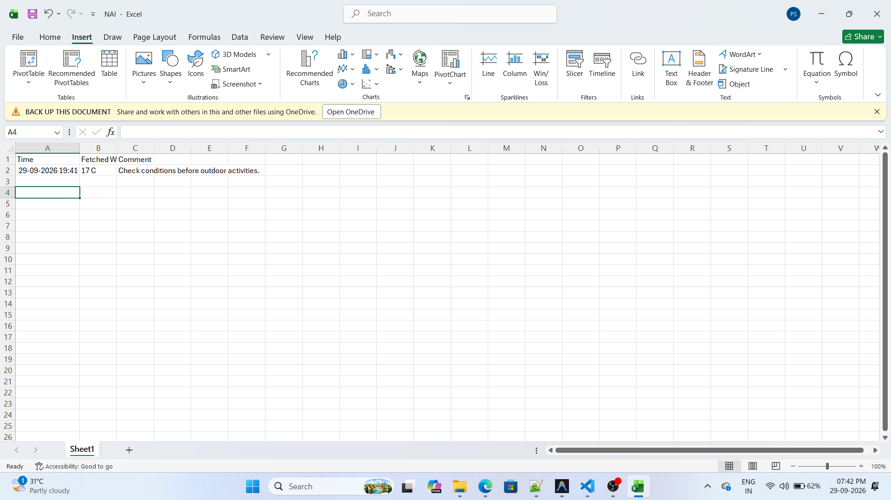
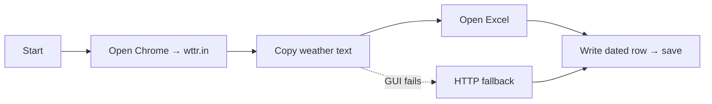

# Daily Weather Report Bot (PyAutoGUI)

> A desktop robot that copies today's weather from the browser into an Excel report.

 

## Overview

A **robotic process automation (RPA)** example on Windows. The script drives the keyboard and mouse with PyAutoGUI: it opens Chrome, loads the weather from [wttr.in](https://wttr.in), copies it, opens Excel and writes a dated row. If any GUI step fails, it falls back to fetching the data over HTTP and writing the workbook directly, so the report is always produced.

## Features

- Keyboard/mouse automation of Chrome and Excel
- Clipboard capture with pyperclip
- HTTP fallback for weather data
- Fallback workbook creation without Excel
- Dated daily report file

## Demo



## How it works



## Tech stack

| Layer | Technology |
|---|---|
| RPA | PyAutoGUI, pyperclip |
| Data source | wttr.in |
| Output | Excel (.xlsx) |
| OS | Windows |

## Project structure

```text
.
├── daily_report_bot.py
├── daily_report_2026-09-29.xlsx   # sample output
├── daily_report_2026-09-29.png
└── requirements.txt
```

## Getting started

**Prerequisites:** Python 3.10+, Windows with Chrome and Microsoft Excel

```bash
git clone https://github.com/prasanth-sundararajan/PyAutoGUI_Automation.git
cd PyAutoGUI_Automation
python -m venv .venv
# Windows: .venv\Scripts\activate    macOS/Linux: source .venv/bin/activate
pip install -r requirements.txt
```

## Usage

```bash
python daily_report_bot.py
```
Don't touch the mouse or keyboard while it runs. Move the mouse to a screen corner to trigger PyAutoGUI's fail-safe stop.

## Notes

- Change `WEATHER_URL` in the script to use your city.

## License

Released under the [MIT License](LICENSE).

## Author

**Prasanth Sundararajan**, Senior SRE and AI Engineer  
[LinkedIn](https://www.linkedin.com/in/prasanth-s-a093a7109/) · [GitHub](https://github.com/prasanth-sundararajan)
